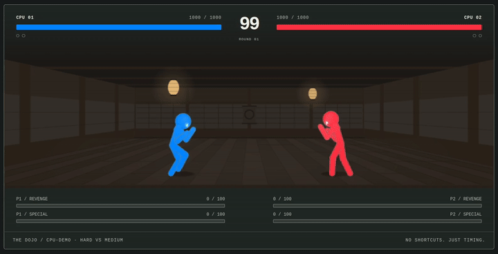

# Stickman Fighter



[](package.json)
[](package.json)
[](https://www.typescriptlang.org/)
[](https://vite.dev/)
[](https://vitest.dev/)
[](https://github.com/sinusphi/stickman-fighter/blob/main/LICENSE)

[English](README.md) · **Deutsch**

[▶ Spiel starten](https://stickman-fighter.sinusphi.com/)

Ein lokales Kampfspiel für zwei Personen mit Strichmännchen, entwickelt mit TypeScript und Canvas 2D. Es verbindet deterministische Kämpfe mit 60 Hz mit Tastatur- und Gamepad-Steuerung, CPU-Gegnern, Trainingswerkzeugen, Replays und mehreren Arenen.


## Funktionen

- Lokaler Versus-, CPU- und CPU-gegen-CPU-Modus; gegen die CPU wahlweise als P1 oder P2
- Runden-Intro im Versus: BEREITMACHEN!, beide Figuren laufen ein, Faustgruß, dann LOS!
- 37 Angriffe im Stand, in der Hocke und in der Luft sowie Dreh-, Tornado- und Komboangriffe, dazu zwei Würfe (Hüftwurf und Schulterwurf mit Seitenwechsel)
- Revenge-Kombo: mit voller Revenge-Leiste eine Comeback-Kombo mit sieben Treffern in drei Varianten (Viertelkreis + LP, LK oder RLK)
- Wirbel: mit voller Special-Leiste ein 360°-Drehtritt, der hinten und vorne trifft
- Blocken, Springen, Rennen (Doppeltipp vorwärts), Best-of-three-Matches und Kampfbalken mit „Leiste voll“-Burst, Sound und READY-Anzeige
- Treffereffekte: Funken, Screen-Shake, Staub, Speed-Lines, K.-o.-Blitz und Kombo-Zähler (in den Einstellungen abschaltbar)
- Survival-Modus: endlos Gegner von beiden Seiten, die überlebte Zeit ist der Highscore
- Trainingsmodus, Kampfboxanzeige, Einzelschritt und Animationsvorschau
- Deterministische Replay-Aufnahme sowie Import und Export
- Konfigurierbare Tastatur- und Gamepad-Steuerung
- Deutsche und englische Oberfläche, helles und dunkles Theme sowie drei Arenen


## Voraussetzungen

- Node.js 22.12+ (22.x), 24.x oder 26+
- npm


## Schnellstart

```sh
npm ci
npm run dev
```

Anschließend die im Terminal angezeigte Adresse öffnen, normalerweise <http://127.0.0.1:5173>.


## Standardsteuerung

| Aktion | Spieler 1 | Spieler 2 | Gamepad |
|---|---|---|---|
| Bewegung | W / A / S / D | Pfeiltasten | D-Pad / linker Stick |
| Leichter / mittlerer / schwerer Schlag | R / T / Y | Numpad 7 / 8 / 9 | X / Y / RB |
| Linker Low- / Middle- / Highkick | F / G / H | Numpad 4 / 5 / 6 | A / unbelegt / RT |
| Rechter Low- / Middle- / Highkick | V / B / N | Numpad 1 / 2 / 3 | unbelegt / B / unbelegt |
| Wurf (mit 6 oder 4) | C | Numpad 0 | LB |
| Pause | P | P | — |

Richtungen gelten relativ zum Gegner: **6** vorwärts, **4** zurück, **2** hocken und **7/8/9** springen. **Rennen:** zweimal schnell vorwärts tippen (innerhalb von 12 Frames) und beim zweiten Druck halten; das funktioniert mit Tastatur, D-Pad und Stick gleich. Loslassen stoppt sofort; Hocken, Springen (normaler Vorwärtssprung), Angreifen, Blocken (zurück), ein Treffer oder Kontakt mit dem Gegner beenden das Rennen ebenfalls. Einen eigenen Lauf-Angriff gibt es nicht. Würfe: **6 + Wurf** Hüftwurf, **4 + Wurf** Schulterwurf (der Gegner landet hinter dir). Sie greifen nur einen stehenden oder hockenden Gegner in Armreichweite, sind nicht blockbar, und ein Fehlgriff hat eine lange Recovery. Numpad 0 ist der Code `Numpad0` (die Taste „0 / Einfg“, unabhängig von NumLock), nicht die separate Einfg-Taste. Mit **Backspace** wird ein Match neu gestartet. Die Belegung kann im Spiel geändert werden.


## Runden-Intro

Jede Versus-Runde (auch gegen die CPU und in der Demo, nicht im Training und nicht im Survival) beginnt mit einem kurzen Intro von etwa zwei Sekunden:

1. **BEREITMACHEN!** Beide Figuren stehen an ihren Startpositionen.
2. Beide laufen automatisch aufeinander zu, bis sich die Spitzen der ausgestreckten Fäuste eines Standing-LP genau berühren würden. Der Abstand kommt aus der gebackenen Kontaktgeometrie des Moves, nicht aus einer festen Zahl.
3. **Faustgruß:** Beide spielen die Standing-LP-Animation ohne Hitbox, Schaden oder Leistenzuwachs; die Fäuste treffen sich auf dem Höhepunkt mit einem kleinen Funken.
4. **LOS!** Die Eingaben werden freigegeben und der Rundentimer startet. Die Figuren stehen dort, wo sie sich gegrüßt haben, knapp außer Reichweite.

Bis LOS sind die Eingaben gesperrt; eine durchs Intro gehaltene Taste zählt nicht als Druck. Das Intro gehört zur deterministischen Simulation und wird in Replays aufgezeichnet. `?intro=off` in der URL überspringt das Intro (für die Browser-Smokes anderer Features).

## Revenge-Kombo

Die Revenge-Leiste füllt sich, während du Treffer einsteckst (voll nach rund 400 Schaden). Mit voller Leiste startet ein **Viertelkreis vorwärts + LP (236 + LP)** die Revenge-Kombo (P1 von links: S halten, D dazunehmen, S loslassen und D weiter halten, dann R; P2 von rechts: ↓, ↓ + ←, ← + Num7; vorwärts zeigt immer zum Gegner): Jab → Haken → Links Middle → Links High → Rechts Middle → Rechts High → schwerer Fauststoß, zusammen 500 Schaden, mit einem Schritt nach vorn über die ersten beiden Schläge. Der Finisher wirft den Gegner um.

- Der Viertelkreis darf insgesamt bis zu 20 Frames dauern, mit höchstens 8 Frames zwischen den Schritten; LP darf bis zu 3 Frames nach vorwärts kommen, ein kurzes Neutral vor LP ist erlaubt. Auf dem Gamepad: D-Pad oder Stick ↓, ↘, → (zum Gegner), dann LP.
- Nur aus dem Stand am Boden. Die Kombo leert die Leiste beim Start, auch wenn sie verfehlt. Ohne volle Leiste, in der Hocke, in der Luft oder bei unvollständigem bzw. umgekehrtem Viertelkreis bleibt LP der normale Jab. Vorwärts + LK + LMK + HK verbraucht die Leiste nicht mehr (das ist der Spin-Highkick).
- Sitzt der Jab, sitzen alle sieben Treffer: Sie sind dann nicht mehr blockbar, ein hockender Gegner wird durch die Treffer aufgerichtet. Wird der Jab geblockt, bleibt der Rest wie gewohnt blockbar (der Jab muss stehend geblockt werden).
- Startabstand (Mitte zu Mitte): von „Körper berühren sich“ (38 px) bis 93 px gegen einen stehenden, 86 px gegen einen hockenden Gegner.
- Funktioniert im Versus, im Training und im Survival (Stagger bricht sie dort nicht ab). Die CPU setzt sie nicht ein.

### Drei Varianten, ein Viertelkreis

Derselbe Viertelkreis vorwärts startet je nach Taste eine von drei Kombos mit sieben Treffern (Tasten P1, P2 auf dem Numpad in Klammern). Alle drei brauchen die volle Leiste, leeren sie und sind nicht mehr blockbar, sobald der erste Treffer sitzt.

| Taste | Kombo | Start | Charakter | Finisher |
|---|---|---|---|---|
| LP (R / Num7) | `revenge_combo`: Jab → Haken → Links Middle → Links High → Rechts Middle → Rechts High → schwerer Fauststoß | HIGH (stehend blocken) | erst Fäuste, in der Mitte Tritte, Schritt nach vorn über die ersten beiden Schläge | schwerer Fauststoß, zusammen 500 Schaden |
| LK (F / Num4) | `revenge_combo_f`: Rechts Low → Links Low → Rechts Middle → Links Middle → Rechts High → Links High → Stoßtritt | LOW (hockend blocken) | nur Tritte, die Beine wechseln auf der Stelle (12 Frames pro Tritt), langsamer Anlauf für den Finisher | gerader Stoßtritt auf Hüfthöhe, zusammen 490 Schaden, mit 105 Frames die längste |
| RLK (V / Num1) | `revenge_combo_v`: Haken → Jab → Haken → Rechts Low → Links Middle → Links High → Uppercut | MID (hockend blocken) | schnellster Start (8 Frames) und schneller Faustrhythmus, dann Low-Kick-Mixup und doppelter linker Tritt | aufsteigender Uppercut aus tiefem Absenken der Hüfte, zusammen 475 Schaden, mit 82 Frames die kürzeste |

- Startabstand (Mitte zu Mitte, ab „Körper berühren sich“ bei 38 px): `revenge_combo_f` bis 96 px gegen einen stehenden, 102 px gegen einen hockenden Gegner; `revenge_combo_v` bis 78 px stehend, 82 px hockend.
- Ohne volle Leiste bleiben die Tasten die normalen Einzelangriffe (LK linker Low Kick, RLK rechter Low Kick). Die CPU setzt keine davon ein.


## Wirbel (Special)

Die Special-Leiste füllt sich mit deinen eigenen Treffern (geblockte geben nur wenig). Mit voller Leiste startet **zurück (4) + LP + LK + MK** gleichzeitig den Wirbel: einen 360°-Drehtritt mit dem hinteren Bein, der zuerst gerade nach hinten und dann vorne auf Hüfthöhe trifft, je ein Treffer pro Seite (50 + 60 Schaden). Ein Befreiungsschlag, kein Finisher.

- Spieler 1: **A** halten und **R + F + B** drücken; Spieler 2: **→** halten und **Numpad 7 + 4 + 2** drücken. Gamepad (Standardbelegung): zurück + **X + A + B** (Buttons 2, 0, 1). Die Tasten dürfen bis zu 3 Frames (50 ms) versetzt kommen.
- Nur aus dem Stand am Boden. Der Wirbel leert die Leiste beim Start, auch wenn er verfehlt. Ohne volle Leiste wirken dieselben Tasten genau wie bisher (Spin-Middlekick). Rückwärtshalten dreht im Survival nicht um, nur der Doppeltipp.
- Startup 9 Frames, keine Unverwundbarkeit. Beide Treffer sind MID (hockend blocken) und werfen alles bis zur Stabilität des Bruisers um (Versus-Gegner, im Survival Rookie bis Bruiser); schwere Gegner und Minibosse stecken den Treffer nur ein.
- Reichweite bei Angriffsbeginn (Mitte zu Mitte): vorne bis 89 px gegen einen stehenden, 81 px gegen einen hockenden Gegner; hinten bis 85 / 78 px. Das Rückwärtshalten macht im Eingabeframe 2 px Schritt weg, der Startabstand vorne liegt also bei 87 / 79 px.
- Funktioniert im Versus, im Training und im Survival. Die CPU setzt ihn nicht ein.


## Survival-Modus

**F10** (oder der Survival-Button) startet den Modus, erneut F10 führt zurück in den Versus. Du startest in der Mitte der Arena (mit der P1-Belegung, oder mit der P2-Belegung, wenn der Seiten-Button auf P2 steht; der Auto-Block deiner Seite gilt), von links und rechts laufen immer wieder Gegner herein. Der Lauf endet erst, wenn deine Energie leer ist; die überlebte Zeit ist der Highscore, die Bestzeit merkt sich der Browser. **Backspace** startet einen neuen Lauf.

- Deine Blickrichtung bleibt fest: Rückwärtslaufen dreht dich nicht um. **Doppeltipp nach hinten** dreht dich um (kurze Drehanimation, währenddessen kein Angriff). Ein einzelner Druck nach hinten kann weiterhin einen Command-Move einleiten. Rennen (Doppeltipp **vorwärts** und halten) funktioniert entlang deiner Blickrichtung wie im Versus; Gegner rennen nicht.
- Nur wenige Gegner vor dir greifen gleichzeitig an, die anderen lauern auf Abstand. Gegner im Rücken greifen selten an, und jeder Angriff von hinten wird angekündigt: Der Angreifer blinkt und zeigt ein **!**. Angriffe in den Rücken lassen sich nicht blocken.
- Der Finisher der Fünfer-Combo wirft den Gegner in allen Modi um; im Survival werfen auch andere schwere Treffer den Basisgegner um.
- **Würfe:** Nur du wirfst, die Gegner nicht. Hüft- und Schulterwurf funktionieren wie im Versus und greifen den nächsten Gegner in Armreichweite, im Survival auch einen, der gerade im Hitstun steckt. Jeder Wurf wirft um und bringt Energie wie ein normaler Treffer, die Leisten füllen sich wie im Versus. Schwere Gegner sind werfbar, Minibosse schütteln jeden Wurf ab (der Versuch läuft ins Leere). Während du wirfst und kurz danach startet kein Gegner einen neuen Angriff; ein schon laufender Angriff kann den Wurf aber noch abbrechen.
- Es gibt mehrere Gegnertypen von sehr leicht bis schwer (eigene Energie, Stabilität, Aggressivität und Reaktionszeit). Jeder Treffer bringt den Gegner aus dem Gleichgewicht; ist seine Standfestigkeit voll, fällt er um: ein sehr leichter Gegner nach etwa fünf Treffern, bei einer Combo nach etwa drei. Schwerere Typen halten mehr aus.
- Der Director füllt die Gegnerplätze aus einem Schwierigkeitsbudget, das mit der Spielzeit wächst, immer mit einer Mischung aus leichten und mittleren Typen und gelegentlich einem schweren. Ein gefallener leichter Gegner wird meist durch einen leichten ersetzt. Dazwischen kommen kleine Wellen mit ein paar Extra-Gegnern.
- **Miniboss:** Der erste erscheint nach 30 Sekunden Spielzeit. Solange ein Boss lebt, steht der Boss-Timer still und sonst greift niemand an (Duell: alle anderen schauen vom Rand zu). Hat der Boss die Arena verlassen, folgt der nächste nach 45 Sekunden, jeder härter als der vorige. Fällt ein Boss, greifen die wartenden Gegner sofort wieder an.
- **Energie:** Jeder Treffer und jedes K.O. gibt etwas Energie zurück, ein Miniboss deutlich mehr (über 100 % hinaus als Reserve). Die Gains sinken mit der Spielzeit langsam.
- **Upgrades:** Nach jedem besiegten Miniboss (sobald der Gegenangriff der wartenden Gegner vorbei ist) hält der Lauf an und du wählst eines von drei zufälligen Upgrades: Tasten **1 / 2 / 3** oder ← → und eine beliebige Angriffstaste mit deiner eigenen Steuerung (Tastatur oder Gamepad). Dasselbe Upgrade kann bis zu seinem Limit mehrfach gewählt werden. Gewählte Upgrades stehen als kurze Kürzel unter deiner Energieleiste und werden im Endbildschirm aufgelistet. Direkt nach der Wahl startet kurz kein Gegner einen neuen Angriff.

| Upgrade | Kürzel | Pro Wahl | Limit |
|---|---|---|---:|
| Max-Energie | HP+ | +100 volle Energie, heilt sofort 150 | 4 |
| Energie-Gewinn | GEW | +25 % Energie aus Treffern, K.O.s und Bossen | 3 |
| Schaden | SCH | +15 % Schaden (Schläge, Tritte, Würfe) | 4 |
| Revenge | REV | Revenge-Leiste füllt sich 30 % schneller | 3 |
| Special | SPZ | Special-Leiste füllt sich 30 % schneller (Treffer und Blocks) | 3 |
| Deckung | DCK | Geblockte Treffer kosten 50 % weniger und geben +3 Energie | 2 |
| Standfest | STF | +30 Standfestigkeit: die erste Wahl hält den Wirbel aus (Stärke 160), die zweite das Finale der Fünfer-Kombo (200); Revenge und Treffer in der Luft werfen dich weiter um | 2 |
| Rückensinn | RÜK | Angriffe von hinten warnen 12 Frames (0,2 s) länger | 3 |

  Die Karten kommen aus einem eigenen, geseedeten Zufallsstrom des Laufs: Derselbe Seed bietet dieselben Karten an, und die Wahl ändert nie, welche Gegner kommen. Versus, Training und Replays sind nicht betroffen.

Alle Survival-Werte (Gegnertypen, Schwierigkeitsbudget, Boss-Zeiten, Energie-Gains, Gegnerzahl, Angriffs-Tokens, Rücken-Budget, Cooldowns, Wurf-Schonfrist, Schwellwerte, Drehzeit, Upgrades) stehen in `src/survival/config.ts`, Trefferstärke und Knockdown in `src/data/rules.json` (`hitStrength`).

### Balance-Lauf

`npm run balance:survival` misst die Survival-Balance headless: Ein Spieler-Bot spielt viele komplette Läufe auf der deterministischen Simulation durch (ohne Browser) und schreibt `summary.md`, `runs.csv` und `minutes.csv` nach `test-results/survival-balance/`: Median sowie 10./90. Perzentil der überlebten Zeit, Kills pro Gegnertyp, erreichter Boss, Todesursache (letzter Schadensgeber: Typ, vorne/hinten, Boss) und die Energiebilanz je Minute.

```sh
npm run balance:survival -- --runs 200 --seed 1 --profile all --max-seconds 600
```

`--profile` ist `defensive`, `aggressive` oder `all`. Nach jedem Boss wählt der Bot eine zufällige Upgrade-Karte; `--prefer <id>` (z. B. `--prefer damage`) nimmt dieses Upgrade, wann immer es angeboten wird, `--upgrades off` schaltet die Angebote ab. Die Wirkung eines Upgrades misst man gegen `--upgrades off` auf denselben Seeds. Der Bot nutzt die Versus-CPU gegen jeweils einen Gegner und ergänzt Umdrehen per Doppeltipp und Reaktionen auf Rücken-Warnungen. **Er ist kein Mensch:** Die Zahlen taugen für Vorher/Nachher-Vergleiche einer Tuning-Änderung in `src/survival/config.ts` (gleiche Seeds, gleiches Profil, gleiches Limit), nicht als absolute Überlebenszeiten. Derselbe Seed ergibt immer denselben Lauf.


## Moveliste

<details>
<summary>Alle Angriffe mit Eingabe und Framedaten</summary>

<!-- move-table:start (generated by npm run generate:move-table) -->
43 Moves. Richtungen relativ zum Gegner (6 vorwärts, 4 zurück); Tasten für die Ausgangsaufstellung mit Standardbelegung (P1 links, P2 rechts). Frames bei 60 Hz, Startup gezählt ab Frame 0. Knie-Treffergruppen der stehenden Middle-/Highkicks sind im Schaden mit aufgeführt. Würfe greifen einen stehenden oder hockenden, handlungsfähigen Gegner bis 36 px vor der eigenen Pushbox; Frame-Daten der Würfe: Greif-Frame / Recovery beim Fehlgriff, Schaden beim Aufprall.

| Move | ID | Eingabe | P1 | P2 | Startup / Aktiv / Recovery | Dauer | Schaden | Block-Level |
|---|---|---|---|---|---|---:|---|---|
| Stand LP | `standing_lp` | Stand · LP | R | Num7 | 5 / 3 / 10 | 18 | 30 | HIGH |
| Stand MP | `standing_mp` | Stand · MP | T | Num8 | 8 / 3 / 17 | 28 | 55 | MID |
| Stand HP | `standing_hp` | Stand · HP | Y | Num9 | 8 / 3 / 17 | 28 | 85 | HIGH |
| Stand LK | `standing_lk` | Stand · LK | F | Num4 | 17 / 3 / 10 | 30 | 35 | LOW |
| Stand MK | `standing_mk` | Stand · MK | B | Num2 | 17 / 3 / 10 | 30 | 65 + 30 | MID |
| Stand HK | `standing_hk` | Stand · HK | H | Num6 | 17 / 3 / 10 | 30 | 95 + 30 | HIGH / MID |
| Hocke LP | `crouching_lp` | Hocke · LP | S halten + R | ↓ halten + Num7 | 5 / 3 / 10 | 18 | 25 | MID |
| Hocke MP | `crouching_mp` | Hocke · MP | S halten + T | ↓ halten + Num8 | 8 / 3 / 15 | 26 | 50 | MID |
| Hocke HP | `crouching_hp` | Hocke · HP | S halten + Y | ↓ halten + Num9 | 8 / 3 / 15 | 26 | 80 | MID |
| Hocke LK | `crouching_lk` | Hocke · LK | S halten + F | ↓ halten + Num4 | 17 / 3 / 9 | 29 | 30 | LOW |
| Sprung LP | `airborne_lp` | Sprung · LP | im Sprung R | im Sprung Num7 | 5 / 4 / 11 | 20 | 30 | MID |
| Sprung MP | `airborne_mp` | Sprung · MP | im Sprung T | im Sprung Num8 | 8 / 5 / 15 | 28 | 50 | MID |
| Sprung HP | `airborne_hp` | Sprung · HP | im Sprung Y | im Sprung Num9 | 8 / 5 / 15 | 28 | 75 | MID |
| Sprung LK | `airborne_lk` | Sprung · LK | im Sprung F | im Sprung Num4 | 19 / 4 / 9 | 32 | 35 | LOW |
| Sprung MK | `airborne_mk` | Sprung · MK | im Sprung B | im Sprung Num2 | 19 / 4 / 9 | 32 | 60 | MID |
| Sprung HK | `airborne_hk` | Sprung · HK | im Sprung H | im Sprung Num6 | 19 / 4 / 9 | 32 | 90 | MID |
| Spin Middle Kick | `spin_mk` | 4 + MK | A halten + B | → halten + Num2 | 18 / 6 / 29 | 53 | 80 | MID |
| Spin High Kick | `spin_hk` | 6 + HK | D halten + H | ← halten + Num6 | 17 / 3 / 10 | 30 | 110 | HIGH |
| Stand RLK | `standing_rlk` | Stand · RLK | V | Num1 | 17 / 3 / 10 | 30 | 35 | LOW |
| Stand LMK | `standing_lmk` | Stand · LMK | G | Num5 | 17 / 3 / 10 | 30 | 65 + 30 | MID |
| Stand RHK | `standing_rhk` | Stand · RHK | N | Num3 | 17 / 3 / 10 | 30 | 95 + 30 | HIGH / MID |
| Hocke RLK | `crouching_rlk` | Hocke · RLK | S halten + V | ↓ halten + Num1 | 17 / 3 / 9 | 29 | 30 | LOW |
| Sprung RLK | `airborne_rlk` | Sprung · RLK | im Sprung V | im Sprung Num1 | 19 / 4 / 9 | 32 | 35 | LOW |
| Sprung LMK | `airborne_lmk` | Sprung · LMK | im Sprung G | im Sprung Num5 | 19 / 4 / 9 | 32 | 60 | MID |
| Sprung RHK | `airborne_rhk` | Sprung · RHK | im Sprung N | im Sprung Num3 | 19 / 4 / 9 | 32 | 90 | MID |
| Tornado Kick | `tornado_mk` | 6 + MK | D halten + B | ← halten + Num2 | 28 / 5 / 22 | 55 | 80 | MID |
| Spin Kick (links) | `forward_spin_hk` | 4 + HK | A halten + H | → halten + Num6 | 17 / 3 / 10 | 30 | 100 | HIGH |
| Tornado → Spin Kick | `tornado_spin_combo` | 6 + MK + HK | D halten + B + H | ← halten + Num2 + Num6 | 28 / 32 / 10 | 70 | 80 + 100 | MID / HIGH |
| Jumping Uppercut | `jumping_uppercut` | 6 + HP | D halten + Y | ← halten + Num9 | 12 / 9 / 35 | 56 | 85 | HIGH |
| Dwit Chagi | `dwit_chagi` | 4 + RLK | A halten + V | → halten + Num1 | 19 / 4 / 27 | 50 | 105 | HIGH |
| Left Turn Kick | `left_turn_kick` | 4 + LK | A halten + F | → halten + Num4 | 18 / 4 / 44 | 66 | 70 | HIGH |
| Double High Kick | `double_high_kick` | 4 + LK + LMK | A halten + F + G | → halten + Num4 + Num5 | 18 / 30 / 30 | 78 | 60 + 80 | HIGH |
| Spin High → Spin Middle | `spin_high_middle_combo` | 6 + RLK + MK | D halten + V + B | ← halten + Num1 + Num2 | 17 / 36 / 29 | 82 | 110 + 80 | HIGH / MID |
| Middle → High → Low | `middle_high_low_combo` | 6 + LMK + MK | D halten + G + B | ← halten + Num5 + Num2 | 17 / 37 / 13 | 67 | 65 + 95 + 35 | MID / HIGH / LOW |
| Right Middle → High → Left Middle → High → Medium Punch | `middle_high_punch_combo` | 6 + HK + RHK | D halten + H + N | ← halten + Num6 + Num3 | 17 / 66 / 14 | 97 | 65 + 95 + 65 + 95 + 50 | MID / HIGH |
| Medium Punch → Right High | `punch_kick_combo` | 6 + MP + RHK | D halten + T + N | ← halten + Num8 + Num3 | 8 / 15 / 11 | 34 | 55 + 95 | MID / HIGH |
| Right Middle → Body Hook | `kick_punch_combo` | 4 + MK + HP | A halten + B + Y | → halten + Num2 + Num9 | 17 / 16 / 14 | 47 | 65 + 85 | MID |
| Hüftwurf | `throw_forward` | 6 + THROW | D halten + C | ← halten + Num0 | 4 / 1 / 22 (Fehlgriff) | 27 | 110 | nicht blockbar (Wurf) |
| Schulterwurf | `throw_back` | 4 + THROW | A halten + C | → halten + Num0 | 4 / 1 / 22 (Fehlgriff) | 27 | 130 | nicht blockbar (Wurf) |
| Revenge-Kombo: Jab → Haken → Links Middle → Links High → Rechts Middle → Rechts High → schwerer Fauststoß (volle Revenge-Leiste) | `revenge_combo` | 236 + LP | S, S + D, D + R | ↓, ↓ + ←, ← + Num7 | 6 / 61 / 10 | 77 | 40 + 60 + 65 + 80 + 65 + 80 + 110 | HIGH / MID |
| Wirbel: 360°-Drehtritt, hinten und vorne (volle Special-Leiste) | `special_spin` | 4 + LP + LK + MK | A halten + R + F + B | → halten + Num7 + Num4 + Num2 | 9 / 11 / 22 | 42 | 50 + 60 | MID |
| Revenge-Kombo F: Rechts Low → Links Low → Rechts Middle → Links Middle → Rechts High → Links High → Stoßtritt (volle Revenge-Leiste) | `revenge_combo_f` | 236 + LK | S, S + D, D + F | ↓, ↓ + ←, ← + Num4 | 10 / 79 / 16 | 105 | 35 + 35 + 55 + 60 + 80 + 90 + 135 | LOW / MID / HIGH |
| Revenge-Kombo V: Haken → Jab → Haken → Rechts Low → Links Middle → Links High → Uppercut (volle Revenge-Leiste) | `revenge_combo_v` | 236 + RLK | S, S + D, D + V | ↓, ↓ + ←, ← + Num1 | 8 / 64 / 10 | 82 | 45 + 40 + 60 + 45 + 65 + 85 + 135 | MID / HIGH / LOW |
<!-- move-table:end -->

</details>


## Befehle

| Befehl | Zweck |
|---|---|
| `npm run dev` | Entwicklungsserver starten |
| `npm run build` | Typen prüfen und Produktionsbuild erstellen |
| `npm run preview` | Produktionsbuild lokal anzeigen |
| `npm test` | Tests im Beobachtungsmodus ausführen |
| `npm run check` | Vollständige Prüfung ausführen |
| `npm run balance:survival` | Headless Survival-Balance-Lauf (Bot, siehe Survival-Modus) |


## Projektstruktur

- `src/simulation/` — deterministische Kampf- und Matchlogik
- `src/survival/` — Survival-Modus: Simulation, Director, Gegnersteuerung und Konfiguration
- `src/render/` — Canvas-Darstellung und Animationen
- `src/data/` — Moves, Posen, Regeln und Konfiguration
- `tests/` — Unit- und Integrationstests
- `scripts/` — Datengeneratoren und Browser-Smoke-Tests


## Lizenz

Dieses Projekt ist lizensiert unter der **MIT License**. 
Siehe [LICENSE](https://github.com/sinusphi/stickman-fighter/blob/main/LICENSE) für weitere Details.


## Contributions

Beiträge zum Projekt sind stets willkommen, ebenso Bug Reports und Pull Requests. 

* [Pull requests](https://github.com/sinusphi/stickman-fighter/pulls)

* [Bug reports](https://github.com/sinusphi/stickman-fighter/issues)

* [Feature requests](https://github.com/sinusphi/stickman-fighter/issues)
