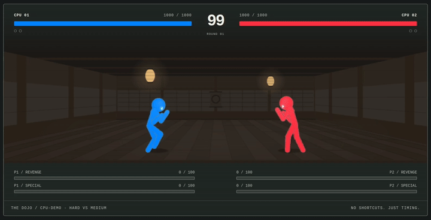

# Stickman Fighter



[](package.json)
[](package.json)
[](https://www.typescriptlang.org/)
[](https://vite.dev/)
[](https://vitest.dev/)
[](https://github.com/sinusphi/stickman-fighter/blob/main/LICENSE)

**English** · [Deutsch](README.de.md)

[▶ Play now](https://stickman-fighter.sinusphi.com/)

A local two-player stick-figure fighting game built with TypeScript and Canvas 2D. 
It combines deterministic 60 Hz combat with keyboard and gamepad controls, CPU opponents, training tools, replays, and multiple arenas.


## Features

- Local versus, CPU, and CPU-versus-CPU modes; against the CPU you can play as P1 or P2
- 37 standing, crouching, airborne, spin, tornado, and combo attacks, plus two throws (hip throw and shoulder throw with side switch)
- Revenge combo: with a full Revenge bar, a seven-hit comeback combo
- Wirbel: with a full Special bar, a 360° spin kick that hits behind and in front
- Blocking, jumping, running (double tap forward), best-of-three matches, and combat meters with a "bar full" burst, sound and READY display
- Hit effects: sparks, screen shake, dust, speed lines, KO flash, and a combo counter (switchable in the settings)
- Survival mode: endless enemies from both sides, the survived time is the score
- Training mode, hitbox display, frame stepping, and animation preview
- Deterministic replay recording, import, and export
- Configurable keyboard and gamepad controls
- English and German interface, light and dark themes, and three arenas


## Requirements

- Node.js 22.12+ (22.x), 24.x, or 26+
- npm


## Getting started

```sh
npm ci
npm run dev
```

Open the address shown in the terminal, usually <http://127.0.0.1:5173>.


## Default controls

| Action | Player 1 | Player 2 | Gamepad |
|---|---|---|---|
| Movement | W / A / S / D | Arrow keys | D-pad / left stick |
| Light / medium / heavy punch | R / T / Y | Numpad 7 / 8 / 9 | X / Y / RB |
| Left low / middle / high kick | F / G / H | Numpad 4 / 5 / 6 | A / unassigned / RT |
| Right low / middle / high kick | V / B / N | Numpad 1 / 2 / 3 | unassigned / B / unassigned |
| Throw (with 6 or 4) | C | Numpad 0 | LB |
| Pause | P | P | — |

Directions are relative to the opponent: **6** forward, **4** back, **2** crouch, and **7/8/9** jump. 
**Run:** tap forward twice quickly (within 12 frames) and hold it on the second press; this works the same on keyboard, D-pad and stick. Releasing forward stops at once; crouching, jumping (normal forward jump), attacking, blocking (back), getting hit or touching the opponent also ends the run. There is no special run attack. 
Throws: **6 + Throw** hip throw, **4 + Throw** shoulder throw (the opponent lands behind you). They only grab a standing or crouching opponent within arm's reach, cannot be blocked, and a missed grab has a long recovery. Numpad 0 is the code `Numpad0` (the "0 / Ins" key, regardless of NumLock), not the separate Insert key. 
Use **Backspace** to restart a match. Controls can be reassigned in the game.


## Revenge combo

The Revenge bar fills while you take hits (full after about 400 damage). With a full bar, **forward (6) + LK + LMK + HK** together starts the Revenge combo: jab → hook → left middle → left high → right middle → right high → heavy punch, 500 damage in total, with a step forward over the first two strikes. The finisher knocks the opponent down.

- Player 1: hold **D** and press **F + G + H**; Player 2: hold **←** and press **Numpad 4 + 5 + 6**. The keys may arrive up to 3 frames (50 ms) apart.
- Only from standing on the ground. The combo empties the bar when it starts, even if it misses. Without a full bar the same keys work exactly as before (spin high kick).
- Once the jab lands, all seven hits land: they cannot be blocked anymore, and a crouching opponent is stood up by the hits. If the jab is blocked, the rest stays blockable as usual (the jab must be blocked standing).
- Start distance (centre to centre): from bodies touching (38 px) up to 93 px against a standing opponent, 86 px against a crouching one.
- Works in versus, training and survival (stagger does not cut it short there). The CPU does not use it. On the gamepad LMK is unassigned by default, so the combo needs a custom binding there.


## Wirbel (Special)

The Special bar fills with your own hits (a trickle on blocked ones). With a full bar, **back (4) + LP + LK + MK** together starts the Wirbel: a 360° spin kick with the rear leg that strikes first straight behind you, then in front at hip height, one hit per side (50 + 60 damage). It is a breakaway strike, not a finisher.

- Player 1: hold **A** and press **R + F + B**; Player 2: hold **→** and press **Numpad 7 + 4 + 2**. Gamepad (default layout): back + **X + A + B** (buttons 2, 0, 1). The keys may arrive up to 3 frames (50 ms) apart.
- Only from standing on the ground. The Wirbel empties the bar when it starts, even if it misses. Without a full bar the same keys work exactly as before (spin middle kick). Holding back does not turn you around in survival; only a double tap does.
- Startup 9 frames, no invulnerability. Both hits are MID (block crouching) and knock down everything up to bruiser stability (versus opponents, survival rookies to bruisers); heavy enemies and minibosses only take the hit.
- Reach at attack start (centre to centre): in front up to 89 px against a standing, 81 px against a crouching opponent; behind up to 85 / 78 px. Holding back steps 2 px away on the input frame, so the start distance in front is 87 / 79 px.
- Works in versus, training and survival. The CPU does not use it.


## Survival mode

Press **F10** (or the Survival button) to start, F10 again returns to versus. You start in the middle of the arena (with the P1 controls, or the P2 controls if the side button is set to P2; auto block applies to your side) while enemies keep walking in from the left and the right. The run only ends when your energy is empty; the survived time is the score, and the best time is kept in the browser. **Backspace** starts a new run.

- Your facing stays fixed: walking backwards does not turn you around. **Double-tap backwards** to turn (a short turn animation; no attacks meanwhile). A single back press can still open a command move. Running (double tap **forward** and hold) works along your facing as in versus; enemies do not run.
- Only a few enemies in front of you attack at the same time, the others lurk at a distance. Enemies behind you rarely attack, and every attack from behind is announced: the attacker flashes and shows a **!**. Attacks into your back cannot be blocked.
- The finisher of the five-hit combo knocks the opponent down in every mode; in survival, other heavy hits also knock the basic enemy down.
- **Throws:** only you throw, the enemies do not. Hip and shoulder throw work as in versus and seize the closest enemy in reach, in survival also one that is in hitstun. Every throw knocks down and gives energy like a normal hit; the bars fill as in versus. Heavy enemies can be thrown, minibosses shrug every throw off (the attempt whiffs). While you throw and shortly after, no enemy starts a new attack; an attack that is already running can still break the throw.
- Enemies come in several types from very light to heavy (own energy, stability, aggression and reaction time). Every hit staggers an enemy; when its poise is full it falls: a very light enemy after about five hits, after about three hits of a combo. Heavier types take more.
- The director fills the enemy slots from a difficulty budget that grows with the run time, always with a mix of light and medium types and now and then a heavy one. A fallen light enemy is mostly replaced by a light one. Small waves add a few extra enemies in between.
- **Miniboss:** the first one appears after 30 seconds of run time. While a boss lives, the boss timer stands still and nobody else attacks (duel: all other enemies just watch from the edge). When the boss has left the arena, the next one follows after 45 seconds, each one tougher. When a boss falls, the waiting enemies attack again at once.
- **Energy:** every landed hit and every KO gives a little energy back, a miniboss a lot (it may fill the energy above 100 % as a reserve). The gains shrink slowly with the run time.
- **Upgrades:** after every fallen miniboss (once the counterattack of the waiting enemies is over) the run pauses and you pick one of three random upgrades: keys **1 / 2 / 3**, or ← → and any attack button with your own controls (keyboard or gamepad). The same upgrade can be picked again up to its limit. Picked upgrades show as short badges below your energy bar and are listed on the game-over screen. Right after the pick no enemy starts a new attack for a moment.

| Upgrade | Badge | Per pick | Limit |
|---|---|---|---:|
| Max energy | HP+ | +100 full energy, heals 150 at once | 4 |
| Energy gain | GAIN | +25 % energy from hits, KOs and bosses | 3 |
| Damage | DMG | +15 % damage (strikes and throws) | 4 |
| Revenge | REV | Revenge bar fills 30 % faster | 3 |
| Special | SPC | Special bar fills 30 % faster (hits and blocks) | 3 |
| Guard | GRD | Blocked hits cost 50 % less and give +3 energy | 2 |
| Stability | STB | +30 stability: the first pick holds the Wirbel (strength 160), the second the finisher of the five-hit combo (200); Revenge and hits in the air still knock you down | 2 |
| Back sense | BCK | Attacks from behind warn 12 frames (0.2 s) longer | 3 |

  The cards come from the run's own seeded random stream: the same seed offers the same cards, and the picks never change which enemies come. Versus, training and replays are not affected.

All survival tuning values (enemy types, difficulty budget, boss times, energy gains, enemy count, attack tokens, back budget, cooldowns, throw grace period, thresholds, turn time, upgrades) are in `src/survival/config.ts`; hit strength and knockdown values are in `src/data/rules.json` (`hitStrength`).

### Balance run

`npm run balance:survival` measures the survival balance headless: a player bot plays many complete runs on the deterministic simulation (no browser) and writes `summary.md`, `runs.csv` and `minutes.csv` to `test-results/survival-balance/`: median and 10th/90th percentile of the survived time, kills per enemy type, boss reached, cause of death (last enemy that dealt damage: type, front/back, boss) and the energy balance per minute.

```sh
npm run balance:survival -- --runs 200 --seed 1 --profile all --max-seconds 600
```

`--profile` is `defensive`, `aggressive` or `all`. After every boss the bot picks a random upgrade card; `--prefer <id>` (e.g. `--prefer damage`) takes that upgrade whenever it is offered, `--upgrades off` switches the offers off. Compare an upgrade's effect against `--upgrades off` on the same seeds. The bot reuses the versus CPU against one enemy at a time and adds turning by double tap and reactions to back warnings. **It is not a human:** use the numbers to compare a tuning change in `src/survival/config.ts` before and after (same seeds, profile and limit), not as absolute survival times. The same seed always gives the same run.


## Move list

<details>
<summary>All attacks with inputs and frame data</summary>

<!-- move-table:start (generated by npm run generate:move-table) -->
41 moves. Directions are relative to the opponent (6 forward, 4 back); keys for the starting positions with default controls (P1 left, P2 right). Frames at 60 Hz, startup counted from frame 0. Knee hit groups of the standing middle/high kicks are included in the damage. Throws grab a standing or crouching opponent that can act, up to 36 px beyond the own pushbox; frame data of throws: grab frame / whiff recovery, damage on impact.

| Move | ID | Input | P1 | P2 | Startup / Active / Recovery | Total | Damage | Block level |
|---|---|---|---|---|---|---:|---|---|
| Standing LP | `standing_lp` | Standing · LP | R | Num7 | 5 / 3 / 10 | 18 | 30 | HIGH |
| Standing MP | `standing_mp` | Standing · MP | T | Num8 | 8 / 3 / 17 | 28 | 55 | MID |
| Standing HP | `standing_hp` | Standing · HP | Y | Num9 | 8 / 3 / 17 | 28 | 85 | HIGH |
| Standing LK | `standing_lk` | Standing · LK | F | Num4 | 17 / 3 / 10 | 30 | 35 | LOW |
| Standing MK | `standing_mk` | Standing · MK | B | Num2 | 17 / 3 / 10 | 30 | 65 + 30 | MID |
| Standing HK | `standing_hk` | Standing · HK | H | Num6 | 17 / 3 / 10 | 30 | 95 + 30 | HIGH / MID |
| Crouching LP | `crouching_lp` | Crouching · LP | hold S + R | hold ↓ + Num7 | 5 / 3 / 10 | 18 | 25 | MID |
| Crouching MP | `crouching_mp` | Crouching · MP | hold S + T | hold ↓ + Num8 | 8 / 3 / 15 | 26 | 50 | MID |
| Crouching HP | `crouching_hp` | Crouching · HP | hold S + Y | hold ↓ + Num9 | 8 / 3 / 15 | 26 | 80 | MID |
| Crouching LK | `crouching_lk` | Crouching · LK | hold S + F | hold ↓ + Num4 | 17 / 3 / 9 | 29 | 30 | LOW |
| Jump LP | `airborne_lp` | Jump · LP | in the air R | in the air Num7 | 5 / 4 / 11 | 20 | 30 | MID |
| Jump MP | `airborne_mp` | Jump · MP | in the air T | in the air Num8 | 8 / 5 / 15 | 28 | 50 | MID |
| Jump HP | `airborne_hp` | Jump · HP | in the air Y | in the air Num9 | 8 / 5 / 15 | 28 | 75 | MID |
| Jump LK | `airborne_lk` | Jump · LK | in the air F | in the air Num4 | 19 / 4 / 9 | 32 | 35 | LOW |
| Jump MK | `airborne_mk` | Jump · MK | in the air B | in the air Num2 | 19 / 4 / 9 | 32 | 60 | MID |
| Jump HK | `airborne_hk` | Jump · HK | in the air H | in the air Num6 | 19 / 4 / 9 | 32 | 90 | MID |
| Spin Middle Kick | `spin_mk` | 4 + MK | hold A + B | hold → + Num2 | 18 / 6 / 29 | 53 | 80 | MID |
| Spin High Kick | `spin_hk` | 6 + HK | hold D + H | hold ← + Num6 | 17 / 3 / 10 | 30 | 110 | HIGH |
| Standing RLK | `standing_rlk` | Standing · RLK | V | Num1 | 17 / 3 / 10 | 30 | 35 | LOW |
| Standing LMK | `standing_lmk` | Standing · LMK | G | Num5 | 17 / 3 / 10 | 30 | 65 + 30 | MID |
| Standing RHK | `standing_rhk` | Standing · RHK | N | Num3 | 17 / 3 / 10 | 30 | 95 + 30 | HIGH / MID |
| Crouching RLK | `crouching_rlk` | Crouching · RLK | hold S + V | hold ↓ + Num1 | 17 / 3 / 9 | 29 | 30 | LOW |
| Jump RLK | `airborne_rlk` | Jump · RLK | in the air V | in the air Num1 | 19 / 4 / 9 | 32 | 35 | LOW |
| Jump LMK | `airborne_lmk` | Jump · LMK | in the air G | in the air Num5 | 19 / 4 / 9 | 32 | 60 | MID |
| Jump RHK | `airborne_rhk` | Jump · RHK | in the air N | in the air Num3 | 19 / 4 / 9 | 32 | 90 | MID |
| Tornado Kick | `tornado_mk` | 6 + MK | hold D + B | hold ← + Num2 | 28 / 5 / 22 | 55 | 80 | MID |
| Spin Kick (links) | `forward_spin_hk` | 4 + HK | hold A + H | hold → + Num6 | 17 / 3 / 10 | 30 | 100 | HIGH |
| Tornado → Spin Kick | `tornado_spin_combo` | 6 + MK + HK | hold D + B + H | hold ← + Num2 + Num6 | 28 / 32 / 10 | 70 | 80 + 100 | MID / HIGH |
| Jumping Uppercut | `jumping_uppercut` | 6 + HP | hold D + Y | hold ← + Num9 | 12 / 9 / 35 | 56 | 85 | HIGH |
| Dwit Chagi | `dwit_chagi` | 4 + RLK | hold A + V | hold → + Num1 | 19 / 4 / 27 | 50 | 105 | HIGH |
| Left Turn Kick | `left_turn_kick` | 4 + LK | hold A + F | hold → + Num4 | 18 / 4 / 44 | 66 | 70 | HIGH |
| Double High Kick | `double_high_kick` | 4 + LK + LMK | hold A + F + G | hold → + Num4 + Num5 | 18 / 30 / 30 | 78 | 60 + 80 | HIGH |
| Spin High → Spin Middle | `spin_high_middle_combo` | 6 + RLK + MK | hold D + V + B | hold ← + Num1 + Num2 | 17 / 36 / 29 | 82 | 110 + 80 | HIGH / MID |
| Middle → High → Low | `middle_high_low_combo` | 6 + LMK + MK | hold D + G + B | hold ← + Num5 + Num2 | 17 / 37 / 13 | 67 | 65 + 95 + 35 | MID / HIGH / LOW |
| Right Middle → High → Left Middle → High → Medium Punch | `middle_high_punch_combo` | 6 + HK + RHK | hold D + H + N | hold ← + Num6 + Num3 | 17 / 66 / 14 | 97 | 65 + 95 + 65 + 95 + 50 | MID / HIGH |
| Medium Punch → Right High | `punch_kick_combo` | 6 + MP + RHK | hold D + T + N | hold ← + Num8 + Num3 | 8 / 15 / 11 | 34 | 55 + 95 | MID / HIGH |
| Right Middle → Body Hook | `kick_punch_combo` | 4 + MK + HP | hold A + B + Y | hold → + Num2 + Num9 | 17 / 16 / 14 | 47 | 65 + 85 | MID |
| Hip Throw | `throw_forward` | 6 + THROW | hold D + C | hold ← + Num0 | 4 / 1 / 22 (whiff) | 27 | 110 | unblockable (throw) |
| Shoulder Throw | `throw_back` | 4 + THROW | hold A + C | hold → + Num0 | 4 / 1 / 22 (whiff) | 27 | 130 | unblockable (throw) |
| Revenge Combo: Jab → Hook → Left Middle → Left High → Right Middle → Right High → Heavy Punch (full Revenge bar) | `revenge_combo` | 6 + LK + LMK + HK | hold D + F + G + H | hold ← + Num4 + Num5 + Num6 | 6 / 61 / 10 | 77 | 40 + 60 + 65 + 80 + 65 + 80 + 110 | HIGH / MID |
| Wirbel: 360° Spin Kick, back and front (full Special bar) | `special_spin` | 4 + LP + LK + MK | hold A + R + F + B | hold → + Num7 + Num4 + Num2 | 9 / 11 / 22 | 42 | 50 + 60 | MID |
<!-- move-table:end -->

</details>


## Scripts

| Command | Purpose |
|---|---|
| `npm run dev` | Start the development server |
| `npm run build` | Type-check and create a production build |
| `npm run preview` | Preview the production build |
| `npm test` | Run tests in watch mode |
| `npm run check` | Run the complete validation suite |
| `npm run balance:survival` | Headless survival balance run (bot, see Survival mode) |


## Project structure

- `src/simulation/` — deterministic combat and match logic
- `src/survival/` — survival mode: simulation, director, enemy control and its configuration
- `src/render/` — Canvas rendering and animation
- `src/data/` — moves, poses, rules, and configuration
- `tests/` — unit and integration tests
- `scripts/` — data generators and browser smoke tests


## License

This project is licensed under the **MIT License**. 
See [LICENSE](https://github.com/sinusphi/stickman-fighter/blob/main/LICENSE) for details.


## Contributions

Contributions are welcome.

* [Pull requests](https://github.com/sinusphi/stickman-fighter/pulls)

* [Bug reports](https://github.com/sinusphi/stickman-fighter/issues)

* [Feature requests](https://github.com/sinusphi/stickman-fighter/issues)
